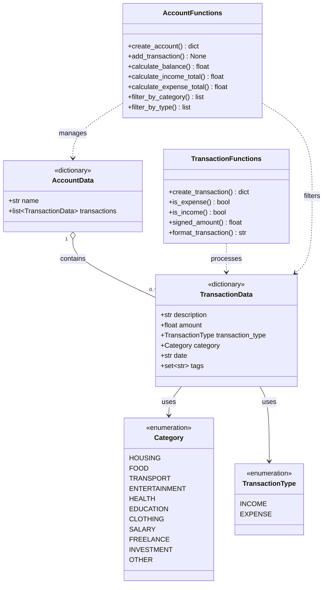
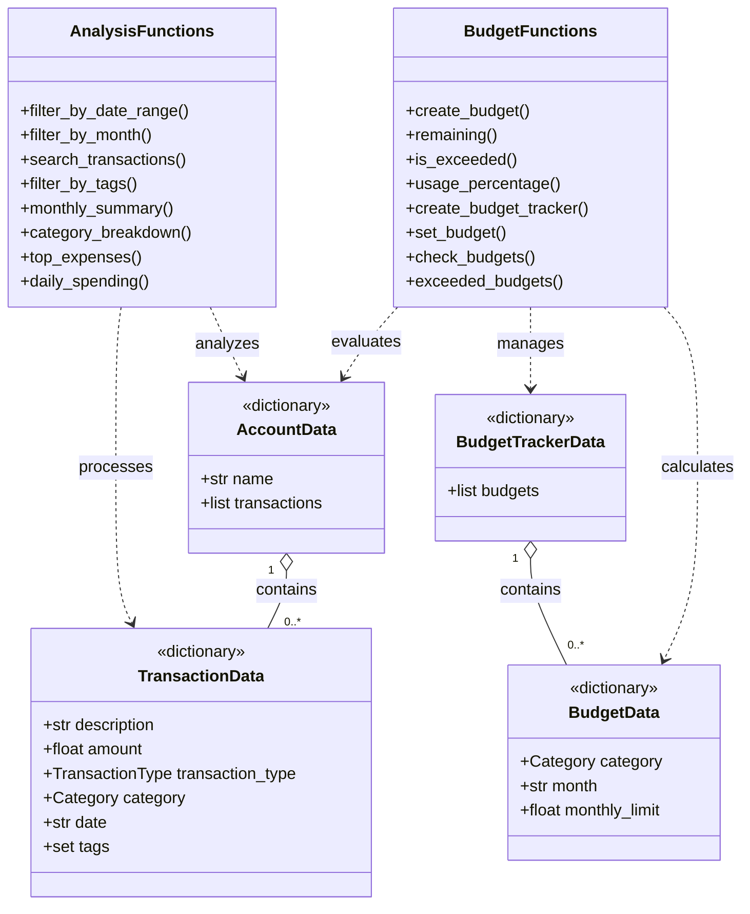
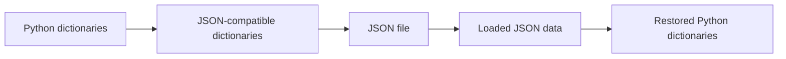
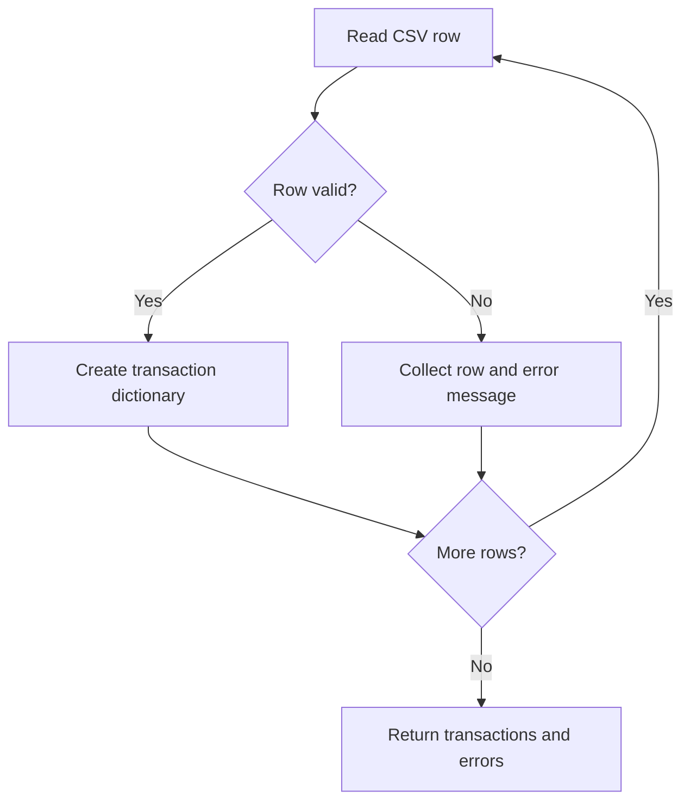
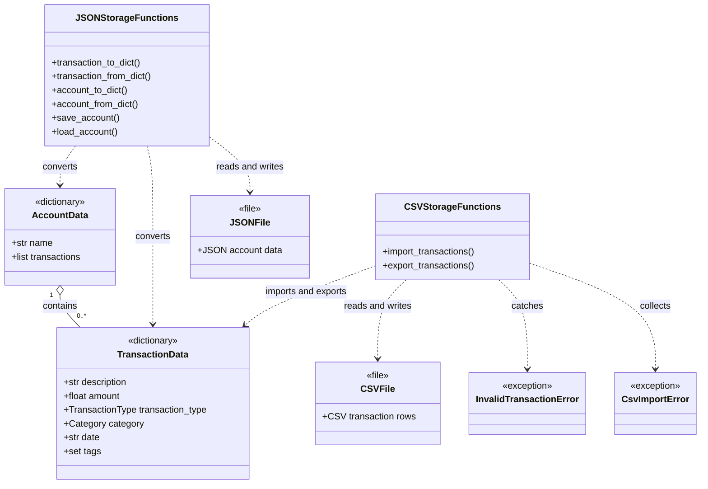
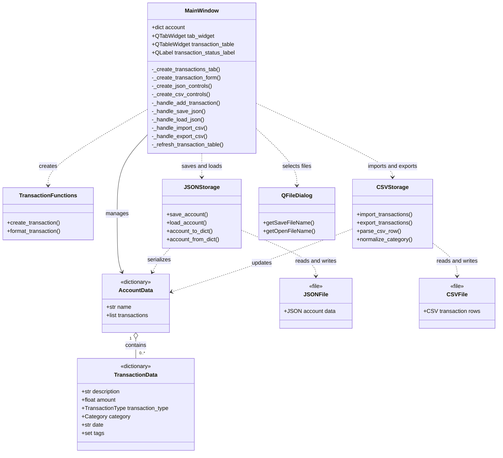
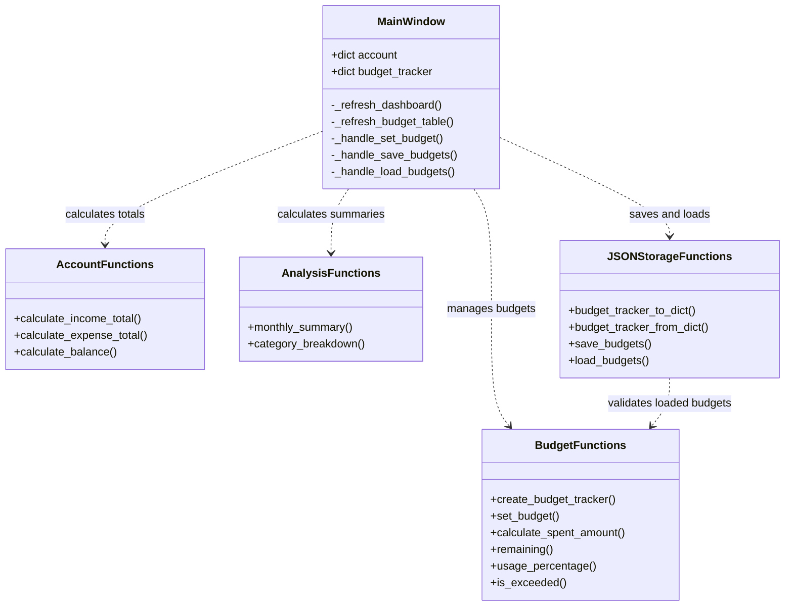
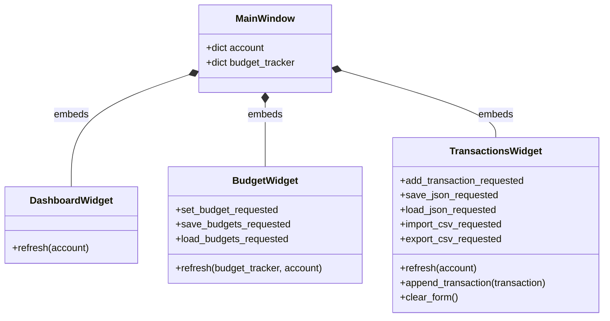

# Personal Finance Tracker

The Personal Finance Tracker manages income and expense transactions.
Its PySide6 desktop interface provides transaction entry, dashboard summaries,
monthly budgets, JSON persistence, and CSV import/export.

Current GitHub test suite: **138 passing tests**, verified on 11 October 2026.
The complete Phase 5 learning workspace passed **144 tests**; two test files
covering six additional cases have not yet been committed to this repository.
Phase 6 will focus on GUI structure and layout.

## Quick start

From the project directory:

```bash
uv sync
uv run python main.py
```

Run the complete test suite:

```bash
uv run pytest -v
```

## Contents

- [Phase 1: Core model](#phase-1-features)
- [Phase 2: Analysis and budgets](#phase-2-features)
- [Phase 3: JSON and CSV persistence](#phase-3---json-and-csv-persistence)
- [Phase 4: PySide6 interface](#phase-4-pyside6-graphical-user-interface)
- [Phase 5: Dashboard and budget integration](#phase-5-dashboard-and-budget-integration)


## Phase 1 features

- Transaction and category enums
- Dictionary-based transaction data
- Dictionary-based account data
- Input validation
- Balance calculation
- Income and expense totals
- Filtering by category
- Filtering by transaction type
- Automated tests with pytest
- Test-driven development

## Phase 1 test baseline

```bash
uv sync
uv run pytest -v
```

Historical result after Phase 1:

```text
33 passed
```

## Phase 1 UML diagram

The following UML diagram shows the dictionary-based structure of Phase 1.



### UML diagram explanation

The diagram represents the dictionary-based domain model used in Phase 1.

#### Multiplicity

- `1` means exactly one element.
- `0..*` means zero, one, or any number of elements.
- Therefore, one account can contain zero or many transactions.

A newly created account initially contains no transactions. After transactions
are added, the same account can contain multiple transaction dictionaries.

#### UML symbols

| Symbol | Meaning |
|---|---|
| `+` | Public field or function |
| `1` | Exactly one element |
| `0..*` | Zero to any number of elements |
| `o--` | Aggregation: an account contains transactions |
| `-->` | Association: one element uses another element |
| `..>` | Dependency: a function creates, reads, or processes data |
| `<<enumeration>>` | A fixed collection of allowed values |
| `<<dictionary>>` | Data is represented by a Python dictionary |
| `: uses` | A transaction uses an enum value |
| `: contains` | An account contains transaction dictionaries |
| `: manages` | Functions manage account data |
| `: filters` | Functions select matching transactions |
| `: processes` | Functions create or process transaction data |

#### Relationships

- `TransactionData --> Category`: Each transaction uses one category, such as `FOOD` or `HOUSING`.
- `TransactionData --> TransactionType`: Each transaction is either `INCOME` or `EXPENSE`.
- `AccountData "1" o-- "0..*" TransactionData`: One account contains zero or many transactions.
- `TransactionFunctions ..> TransactionData`: The functions create, validate, format, and evaluate transaction dictionaries.
- `AccountFunctions ..> AccountData`: The functions create and manage account dictionaries.
- `AccountFunctions ..> TransactionData`: The functions calculate totals and filter transaction dictionaries.

## Test-Driven Development

Phase 1 was developed using the TDD cycle:

1. **RED:** The tests were written before the implementation and initially failed.
2. **GREEN:** The required functions were implemented until all tests passed.
3. **REFACTOR:** The code was reviewed and improved while keeping all tests green.

### RED – failing tests before implementation


### GREEN – all tests passing after implementation


## Phase 2 features

Phase 2 adds filtering, search, analysis, and dictionary-based budget
management.

### Filtering and search

- Inclusive date-range filtering
- Filtering by month
- Filtering by transaction tags
- Case-insensitive regular-expression search

### Financial analysis

- Monthly income, expense, and net summaries
- Expense totals grouped by category
- Ranking of the largest expenses
- Daily expense totals grouped by date

### Budget management

- Dictionary-based budgets
- Dictionary-based budget tracker
- Remaining budget calculations
- Budget usage percentages
- Detection of exceeded budgets
- Replacement of existing budgets for the same category and month

## Testing

Phase 2 was developed with Test-Driven Development:

1. Tests were written before the implementation.
2. The new tests initially failed with `NotImplementedError`.
3. The required functions were implemented.
4. All existing and new tests passed.

```text
64 passed
```

## Phase 2 UML diagram

Phase 2 extends the core model with filtering, search, financial analysis,
budgets, and budget tracking.

The Phase 1 structures remain unchanged. The following diagram focuses on the
new components and their relationships with the existing account and
transaction dictionaries.



---

## Phase 3 - JSON and CSV persistence

Phase 3 adds permanent file storage and data exchange to the Personal Finance
Tracker.

The existing dictionary-based data model remains unchanged. Transactions and
accounts can now be converted into JSON-compatible data, saved to files, loaded
again, imported from CSV files, and exported to CSV files.

### Phase 3 features

#### Phase 3A – JSON storage

- Convert transaction dictionaries into JSON-compatible dictionaries
- Restore Python transaction dictionaries from JSON data
- Convert account dictionaries into JSON-compatible dictionaries
- Restore account dictionaries from JSON data
- Save an account to a JSON file
- Load an account from a JSON file
- Restore enums and sets after loading
- Report missing or invalid files

#### Phase 3B – CSV storage

- Import transactions from CSV files
- Export transactions to CSV files
- Detect positive amounts as income
- Detect negative amounts as expenses
- Convert negative amounts into positive transaction amounts
- Recognize categories case-insensitively
- Continue importing after an invalid row
- Collect invalid rows and their error messages
- Add a summary row during export
- Use custom transaction and CSV row exceptions

### New Phase 3 files

```text
finance_tracker/
├── json_storage.py
├── csv_storage.py
└── exceptions.py

tests/
├── test_json_storage.py
└── test_csv_storage.py
```

#### File responsibilities

| File | Responsibility |
| --- | --- |
| `finance_tracker/json_storage.py` | Converts, saves, and loads JSON data |
| `finance_tracker/csv_storage.py` | Imports and exports transaction CSV files |
| `finance_tracker/exceptions.py` | Defines transaction, CSV row, and budget lookup exceptions |
| `tests/test_json_storage.py` | Tests JSON conversion and file storage |
| `tests/test_csv_storage.py` | Tests CSV import, export, and error handling |

### JSON storage

Python dictionaries can contain values that JSON cannot store directly.

For example:

- `Category` and `TransactionType` are enum values.
- `tags` is represented by a Python set.
- JSON supports strings, numbers, lists, dictionaries, booleans, and `null`.

Before saving, Phase 3 converts:

- enum values into strings,
- sets into lists,
- transaction dictionaries into JSON-compatible dictionaries,
- account dictionaries into JSON-compatible dictionaries.

When the file is loaded, these conversions are reversed.

#### JSON round trip

A round trip means that data is:

1. converted into JSON-compatible data,
2. written to a file,
3. read from the file,
4. restored to its original Python types.



### CSV import

The CSV importer reads one row after another.

Each valid row is converted into a transaction dictionary. If one row is
invalid, the complete import does not stop. Instead, the error is collected and
the importer continues with the next row.



#### Amount interpretation

| CSV amount | Transaction type | Stored amount |
| ---: | --- | ---: |
| `2500.00` | `INCOME` | `2500.00` |
| `-45.50` | `EXPENSE` | `45.50` |
| `0` | Invalid row | Not imported |

The stored amount is always positive because the transaction type already
describes whether the transaction is income or expense.

### CSV export

The CSV exporter writes transaction dictionaries into a CSV file.

The exported file contains:

- one header row,
- one row for every transaction,
- one final summary row.

The summary row provides an overview of the exported transactions.

### Custom exceptions

The existing exception module defines `InvalidTransactionError`, `CsvImportError`,
and `BudgetNotFoundError`.

- `InvalidTransactionError` extends `ValueError` and reports invalid transaction
  data, including invalid CSV fields and categories.
- `CsvImportError` records the line number and reason for an invalid CSV row.
  The importer collects these errors and continues processing later rows.
- `BudgetNotFoundError` extends `LookupError` and is available for budget lookup
  errors; the current budget file controls do not use it.

JSON operations currently use standard Python exceptions such as `OSError`,
`ValueError`, and `json.JSONDecodeError`. The GUI reports handled file errors in
status labels.

### Test-Driven Development

Phase 3 was implemented using Test-Driven Development.

#### RED

The tests were written before the implementation. The new tests initially
failed because the required functions were not implemented.

##### Phase 3A JSON RED


##### Phase 3B CSV RED


#### GREEN

After the required functions were implemented, all existing and new tests
passed.

##### Phase 3A JSON GREEN


##### Phase 3B CSV GREEN


#### Final Phase 3 test result

```text
85 passed
```

The result confirms that the new JSON and CSV features work and that the
features from Phases 1 and 2 still work correctly.

### Phase 3 UML diagram

Phase 3 extends the application with JSON storage, CSV import, CSV export, and
custom exceptions.

The Phase 1 and Phase 2 structures remain available. Phase 3 does not replace
the dictionary-based model. It provides additional functions that translate
between the existing dictionaries and external files.



### Phase 3 UML explanation

The Phase 3 UML diagram shows how the existing dictionary-based domain model
interacts with JSON and CSV files.

#### Existing data structures

`AccountData` represents an account dictionary. It contains the account name and
a list of transaction dictionaries.

`TransactionData` represents one transaction dictionary. It contains the
description, amount, transaction type, category, date, and tags.

One account can contain zero, one, or many transactions.

#### JSON storage functions

`JSONStorageFunctions` represents the functions from `json_storage.py`.

These functions:

- convert transaction dictionaries into JSON-compatible data,
- restore transaction dictionaries from JSON data,
- convert complete account dictionaries,
- restore complete account dictionaries,
- save accounts to JSON files,
- load accounts from JSON files.

The relationship to `JSONFile` shows that the functions read and write JSON
files.

#### CSV storage functions

`CSVStorageFunctions` represents the functions from `csv_storage.py`.

These functions:

- read transaction rows from CSV files,
- convert valid rows into transaction dictionaries,
- collect invalid rows,
- export transaction dictionaries,
- add a summary row to exported files.

The relationship to `CSVFile` shows that the functions read and write CSV
files.

#### Exceptions

`InvalidTransactionError` is a `ValueError` subclass used for invalid CSV
transaction data. `CsvImportError` records a CSV row error for collection by the
importer. These two exceptions do not inherit from each other.

JSON storage uses standard Python exceptions. A `StorageError` class is not
part of the current implementation.

### UML symbols

| Symbol | Meaning |
| --- | --- |
| `+` | Public field or function |
| `1` | Exactly one element |
| `0..*` | Zero to any number of elements |
| `o--` | Aggregation: one structure contains other structures |
| `..>` | Dependency: a component uses another component |
| `<<dictionary>>` | Data is represented by a Python dictionary |
| `<<file>>` | Data is stored in an external file |
| `<<exception>>` | The class represents a custom exception |
| `: contains` | One account contains transaction dictionaries |
| `: converts` | Functions transform data between representations |
| `: reads and writes` | Functions access an external file |
| `: imports and exports` | Functions exchange transaction data with CSV |
| `: catches` | A function handles the specified exception |
| `: collects` | A function records errors for invalid rows |

### Phase 3 relationships

- `AccountData "1" o-- "0..*" TransactionData`
  One account contains zero to any number of transaction dictionaries.

- `JSONStorageFunctions ..> AccountData`
  The JSON functions convert complete account dictionaries.

- `JSONStorageFunctions ..> TransactionData`
  The JSON functions convert individual transaction dictionaries.

- `JSONStorageFunctions ..> JSONFile`
  The JSON functions read and write JSON files.

- `CSVStorageFunctions ..> TransactionData`
  The CSV functions import and export transaction dictionaries.

- `CSVStorageFunctions ..> CSVFile`
  The CSV functions read and write CSV files.

- `CSVStorageFunctions ..> InvalidTransactionError`
  The importer handles invalid rows.

- `CSVStorageFunctions ..> CsvImportError`
  The importer collects each row error with its line number and reason.

### Phase 3 result

Phase 3 provides a complete persistence and data-exchange layer for the Personal
Finance Tracker.

The application can now:

- keep data between program starts,
- exchange transaction data with spreadsheet programs,
- survive individual invalid CSV rows,
- report storage problems with understandable exceptions,
- restore enums and sets after loading JSON,
- verify all functionality with automated tests.

Phase 3 is complete with:

```text
85 passed
```


## Phase 4: PySide6 graphical user interface

Phase 4 adds a desktop graphical user interface to the Personal Finance
Tracker.

The interface is implemented with PySide6. It uses the existing dictionary-based
domain model and the functions developed during Phases 1 to 3. The graphical
user interface does not replace the existing business logic. It provides a
visual layer through which users can enter, display, save, and load financial
data.

Phase 4 is divided into several smaller TDD steps:

- Phase 4A: main application window and transaction table
- Phase 4B: transaction entry form
- Phase 4C: JSON save and load controls
- Phase 4D: CSV import and export controls

### Phase 4A: Main application window

Phase 4A introduces the main PySide6 application window.

The `MainWindow` class represents the central window of the Personal Finance
Tracker. It contains a `QTabWidget`, which makes it possible to organize the
application into separate functional areas.

The first tab is named `Transactions`. It contains a `QTableWidget` that
displays the transactions stored in the current account.

The transaction table contains the following columns:

| Column | Purpose |
| --- | --- |
| Date | Date of the transaction |
| Description | Short description of the transaction |
| Type | Income or expense |
| Category | Financial category |
| Amount | Monetary value of the transaction |
| Tags | Optional keywords associated with the transaction |

The table is initially empty because a newly created account does not contain
any transactions.

#### Phase 4A TDD evidence

The GUI structure was developed with Test-Driven Development.

First, tests were created for the window title, tab widget, transactions tab,
table widget, and table headers. These tests failed before the GUI components
were implemented.

**RED state:**


After implementing the main application window and transaction table, all tests
passed.

**GREEN state:**


### Phase 4B: Transaction form

Phase 4B adds an interactive transaction form to the Transactions tab.

The form contains the following widgets:

| Widget | Purpose |
| --- | --- |
| Description input | Accepts a textual transaction description |
| Amount input | Accepts the transaction amount |
| Transaction type input | Selects income or expense |
| Category input | Selects a financial category |
| Date input | Selects the transaction date |
| Tags input | Accepts optional comma-separated tags |
| Add transaction button | Validates and adds the transaction |
| Status label | Displays success or validation messages |

When the user selects **Add transaction**, the graphical interface reads the
values from the form. It then calls the existing `create_transaction()` function
from the domain layer.

The transaction is therefore validated by the same business logic that was
already tested in Phase 1. The GUI does not duplicate the validation rules.

If the data is valid:

1. A transaction dictionary is created.
2. The transaction is added to the current account.
3. A new row is added to the transaction table.
4. The description, amount, and tags text fields are cleared.
5. A success message is displayed.

If the amount is not a valid number, no transaction is added and the status
label displays a readable validation message. The application remains open and
can continue to be used.

#### Phase 4B TDD evidence

The Phase 4B tests verify that all input widgets exist, valid transactions are
added to the table, successful input clears the appropriate fields, and invalid
amounts are rejected.

**RED state:**


**GREEN state:**


#### Transaction form preview

The completed transaction form allows users to enter a description, amount,
transaction type, category, date, and optional tags. A successful transaction
is immediately shown in the table.


### Phase 4C: JSON file controls

Phase 4C connects the graphical user interface with the JSON storage functions
implemented in Phase 3.

The Transactions tab provides two additional controls:

- **Save JSON** saves the current account to a JSON file.
- **Load JSON** loads an account from a selected JSON file.

Native Qt file dialogs are used so that the user can select the destination or
source file through the operating system.

#### Saving an account

When the user selects **Save JSON**, the application:

1. Opens a save-file dialog.
2. Reads the selected path.
3. Adds the `.json` extension when necessary.
4. Calls `save_account()` from `json_storage.py`.
5. Displays a success message after saving.

If the user cancels the dialog, the application performs no save operation and
the current account remains unchanged.

#### Loading an account

When the user selects **Load JSON**, the application:

1. Opens an open-file dialog.
2. Reads the selected JSON file.
3. Calls `load_account()` from `json_storage.py`.
4. Replaces the current in-memory account with the loaded account.
5. Rebuilds the transaction table from the loaded transaction dictionaries.
6. Displays a success message after loading.

If the dialog is cancelled, the current account and transaction table remain
unchanged.

Storage, conversion, and validation errors are caught by the GUI and displayed
in the status label. This prevents file-related errors from terminating the
application unexpectedly.

#### Phase 4C TDD evidence

The Phase 4C tests verify:

- the existence of the save button,
- the existence of the load button,
- saving to the selected path,
- safe cancellation of the save dialog,
- loading and replacing the current account,
- rebuilding the transaction table after loading,
- safe cancellation of the load dialog.

**RED state:**


**GREEN state:**


### Phase 4D: CSV import and export controls

Phase 4D connects the graphical user interface with the CSV storage functions
implemented in Phase 3. The Transactions tab now provides two additional
buttons:

| Control | Purpose |
| --- | --- |
| `Import CSV` | Reads transactions from a selected CSV file and adds every valid row to the current account |
| `Export CSV` | Writes the current transaction table to a selected CSV file and adds a summary row |

The GUI reuses `import_transactions()` and `export_transactions()` from
`finance_tracker/csv_storage.py`. CSV parsing and validation therefore remain
inside the storage layer instead of being duplicated in the window class.

#### Importing transactions

When the user selects `Import CSV`, the application:

1. Opens a native file-selection dialog.
2. Restricts the selection to CSV files.
3. Returns without changing the account if the dialog is cancelled.
4. Calls `import_transactions()` with the current account and selected path.
5. Adds every valid CSV row as a transaction dictionary.
6. Collects invalid rows without stopping the remaining import.
7. Rebuilds the transaction table from the updated account.
8. Displays the imported and skipped row counts in the status label.

The importer returns a result dictionary with three entries:

| Entry | Meaning |
| --- | --- |
| `imported` | Number of successfully imported transactions |
| `skipped` | Number of rows that could not be imported |
| `errors` | Error objects containing line numbers and reasons for invalid rows |

This design is fault tolerant: one malformed row does not prevent valid rows
later in the file from being processed.

#### Exporting transactions

When the user selects `Export CSV`, the application:

1. Opens a native save-file dialog.
2. Reads the destination selected by the user.
3. Returns without writing a file if the dialog is cancelled.
4. Adds the `.csv` extension when it is missing.
5. Calls `export_transactions()` with the current account and selected path.
6. Writes a header, one row per transaction, and a final summary row.
7. Displays a success message in the status label.

Income values are exported as positive amounts and expense values as negative
amounts. The summary row includes the account balance so that the exported file
can also be inspected in spreadsheet software.

#### Error handling

File-system, conversion, and validation errors are caught by the GUI. Instead
of terminating the application, the window displays a readable message in the
status label. The current in-memory account remains available for further work.

#### Phase 4D TDD evidence

The Phase 4D tests were written before the CSV controls were implemented. The
RED run proves that the new buttons and handlers did not yet exist.

RED state:


After the CSV controls and their handlers were implemented, the new tests and
all tests from the earlier phases passed together.

GREEN state:


The Phase 4D tests verify:

- the existence of the `Import CSV` button,
- the existence of the `Export CSV` button,
- importing valid CSV rows through the GUI,
- refreshing the transaction table after an import,
- displaying imported and skipped row counts,
- exporting to the selected path,
- safe cancellation of import and export dialogs.

### Phase 4 architecture

The Phase 4 GUI is a presentation layer placed on top of the existing
dictionary-based domain and storage logic. `MainWindow` manages the visible
widgets and current account. It delegates validation to the transaction layer
and file operations to the JSON and CSV storage layers.



### Phase 4 UML explanation

#### Components

- `MainWindow` represents the central PySide6 application window.
- `AccountData` represents the current account dictionary.
- `TransactionData` represents one transaction dictionary.
- `TransactionFunctions` represents the existing transaction business logic.
- `JSONStorage` represents JSON conversion, saving, and loading.
- `CSVStorage` represents CSV import, export, parsing, and category normalization.
- `QFileDialog` represents the native Qt file-selection dialogs.
- `JSONFile` and `CSVFile` represent external files selected by the user.

#### Relationships

- `AccountData "1" o-- "0..*" TransactionData` means that one account
  contains zero or multiple transaction dictionaries.
- `MainWindow --> AccountData` means that the main window manages the current
  in-memory account.
- `MainWindow ..> TransactionFunctions` means that the GUI delegates transaction
  creation and validation to the existing domain layer.
- `MainWindow ..> JSONStorage` means that the GUI delegates JSON save and load
  operations to the JSON storage layer.
- `MainWindow ..> CSVStorage` means that the GUI delegates CSV import and export
  operations to the CSV storage layer.
- `MainWindow ..> QFileDialog` means that Qt dialogs select source and destination
  files.
- `JSONStorage ..> JSONFile` and `CSVStorage ..> CSVFile` mean that the storage
  functions read and write their corresponding file formats.

#### Separation of responsibilities

| Layer | Responsibility |
| --- | --- |
| GUI layer | Displays widgets, reads user input, selects files, refreshes the table, and reports results |
| Domain layer | Creates and validates transaction and account dictionaries |
| Storage layer | Converts, imports, exports, saves, and loads JSON and CSV data |
| Test layer | Verifies domain, storage, and GUI behaviour |

This separation avoids duplicating business rules inside the graphical user
interface. It also makes the individual parts easier to test, maintain, and
extend.

### Running the graphical application

From the project directory, start the application with:

```bash
uv run python main.py
```

The window can then be used to add transactions, save or load JSON accounts,
and import or export CSV files.

### Phase 4 testing status

Phase 4A, Phase 4B, Phase 4C, and Phase 4D were developed incrementally with
Test-Driven Development:

1. Tests were written before each implementation.
2. The new tests initially failed.
3. The required GUI functionality was implemented.
4. All existing and new tests were executed together.
5. The complete test suite passed without regressions.

Final result after Phase 4D:

```text
113 passed
```

Phase 4 is now complete. The graphical application supports transaction entry,
table display, JSON persistence, and CSV data exchange while continuing to use
the dictionary-based architecture from the earlier phases.


---

## Phase 5: Dashboard and budget integration

Phase 5 adds financial summaries and connects the existing budget functions to
the PySide6 interface. The application now has three tabs: `Transactions`,
`Dashboard`, and `Budgets`.

### Phase 5A: Dashboard totals

The Dashboard tab displays total income, total expenses, and the account
balance. Values are calculated from the current account and formatted with two
decimal places.

The GUI delegates the calculations to `calculate_income_total()`,
`calculate_expense_total()`, and `calculate_balance()` from `account.py`.

### Phase 5B: Monthly summary

The monthly summary table displays `Month`, `Income`, `Expenses`, and `Balance`.
It uses `monthly_summary()` from `analysis.py` to group transactions by month.
The `net` value returned by this function is displayed in the Balance column.

A newly created account has no monthly rows. Adding transactions, loading an
account, or importing CSV transactions updates the summary.

### Phase 5C: Expenses by category

The category table displays `Category` and `Expenses`. It uses
`category_breakdown()` from `analysis.py` and lists expense totals in descending
order. Income transactions are excluded.

This summary includes all months in the current account. Phase 5 does not add
a dashboard month filter.

#### Phase 5C TDD evidence

- [RED: category expense tests](docs/phase_5c_tdd_red.png)
- [GREEN: category expense tests](docs/phase_5c_tdd_green.png)


#### Phase 5C interface screenshot


### Phase 5D1: Budget overview

The Budgets tab contains a read-only overview of the budgets in the current
tracker.

| Column | Meaning |
| --- | --- |
| Month | Budget month in `YYYY-MM` format |
| Category | Category to which the limit applies |
| Limit | Monthly budget limit |
| Spent | Expenses matching the budget category and month |
| Remaining | Limit minus matching expenses |
| Usage | Matching expenses as a percentage of the limit |
| Status | `Within budget` or `Exceeded` |

The table uses `calculate_spent_amount()`, `remaining()`, `usage_percentage()`,
and `is_exceeded()` from `budget.py`. Income does not count as budget spending.

For example, a Food budget of `300.00` and matching expenses of `195.00` produces
`105.00` remaining and `65.00%` usage. A budget is exceeded only when expenses
are greater than its limit. Exactly `100.00%` is still `Within budget`.

#### Phase 5D1 TDD evidence

- [RED: budget overview tests](docs/phase_5d1_tdd_red.png)
- [GREEN: budget overview tests](docs/phase_5d1_tdd_green.png)


#### Phase 5D1 interface screenshot


### Phase 5D2: Budget form

The form provides a category selection, a monthly limit input, a month
selection, a `Set budget` button, and a status label.

To create or change a budget:

1. Select a category.
2. Enter a positive limit using a decimal point, for example `300.00`.
3. Select the year and month.
4. Select `Set budget`.

The GUI calls `set_budget()` from the existing domain layer. The same category
and month replace an existing budget; a different category or month adds a new
budget. The overview refreshes immediately after successful submission.

Empty input, non-numeric text, zero, negative values, and non-finite numbers
are rejected. Invalid input leaves the existing budget unchanged. Successful
submission keeps the form values available for further edits.

`Budget saved for this session.` confirms an in-memory change. Use
`Save budgets` to write these changes to a file.

### Phase 5D3: Budget JSON files

The Budgets tab provides two file controls:

- `Save budgets` writes the current budget tracker to a JSON file and appends
  `.json` when the filename has no JSON extension.
- `Load budgets` validates a selected JSON file, replaces the budget tracker,
  and refreshes the overview using the current account.

Budget JSON conversion and file access are implemented in `json_storage.py`:

| Function | Responsibility |
| --- | --- |
| `budget_tracker_to_dict()` | Converts category enums into JSON-compatible names and validates the data |
| `budget_tracker_from_dict()` | Restores category enums and validates each budget through the domain layer |
| `save_budgets()` | Writes a validated tracker as UTF-8 JSON |
| `load_budgets()` | Reads JSON and returns a validated tracker |

Example budget file:

```json
{
    "budgets": [
        {
            "category": "FOOD",
            "monthly_limit": 300.0,
            "month": "2026-09"
        }
    ]
}
```

The category is stored as an enum name such as `FOOD`, following the existing
transaction JSON convention. Loading restores `Category.FOOD`.

The loader checks the file structure, required fields, category names, numeric
finite limits, and month strings. Existing domain validation checks positive
limits and valid months. A new tracker is returned only after all entries have
been processed successfully.

Cancelling a file dialog leaves the current state unchanged. Loading errors
are displayed in the budget status label and preserve the existing tracker.
A valid empty budget list clears the overview. Loading replaces budgets rather
than merging them; it does not replace the current account.

### Saving and restoring a complete session

Account transactions and budget limits use separate JSON files.

| Data | Save control | Load control | Example filename |
| --- | --- | --- | --- |
| Account and transactions | `Save JSON` in Transactions | `Load JSON` in Transactions | `account.json` |
| Budget limits | `Save budgets` in Budgets | `Load budgets` in Budgets | `budgets.json` |

Save both files before closing the application. After a restart, load the
account and budget files to restore the data and recalculate the summaries.
There is no automatic save or automatic restore in Phase 5.

### Refresh behaviour

Adding a transaction, loading an account, and importing CSV transactions update
the dashboard totals, monthly summary, category summary, and budget overview.
Setting or loading budgets updates the budget overview immediately.

Tables are rebuilt from the current data so repeated refreshes do not add
duplicate rows. Summary tables are read-only; their values are calculated from
the account and budget dictionaries.

### Phase 5 architecture

The following diagram focuses on the Phase 5 GUI dependencies. The domain model
continues to use dictionaries. Boxes named after modules represent groups of
functions, not additional Python classes.



The GUI creates widgets, reads input, opens dialogs, and reports results. Domain
functions calculate summaries and validate budgets. Storage functions convert
and persist data. `..>` denotes a dependency; `-` denotes an internal method in
this diagram.

### Phase 5 test files

| Test file | Coverage |
| --- | --- |
| `tests/test_dashboard.py` | Dashboard totals |
| `tests/test_dashboard_monthly_summary.py` | Monthly summary columns and values |
| `tests/test_dashboard_category_breakdown.py` | Expense category totals and ordering; not yet committed |
| `tests/test_budget_overview.py` | Budgets tab, overview columns, and monthly values; not yet committed |
| `tests/test_budget_form.py` | Creation, replacement, separate months, and invalid input |
| `tests/test_budget_storage.py` | JSON format, round trips, empty trackers, and invalid files |
| `tests/test_budget_file_controls.py` | GUI save/load, extension handling, cancellation, and failed loading |

Each step used separate RED and GREEN stages. The complete Phase 5 learning
workspace passed `144` tests. The current GitHub repository passes:

```text
138 passed
```

Verified on 11 October 2026 under Linux with Qt running offscreen. The six-test
difference comes from `tests/test_dashboard_category_breakdown.py` and
`tests/test_budget_overview.py`, which are not yet committed. Both contain three
cases. The category summary and budget overview implementations are present.

Run the complete test suite from the project directory:

```bash
uv run pytest -v
```

Run only the Phase 5D3 tests:

```bash
uv run pytest tests/test_budget_storage.py tests/test_budget_file_controls.py -v
```

Start the desktop application:

```bash
uv run python main.py
```

### Phase 5 TDD screenshots

The links below point to screenshots currently committed to the repository.
All RED and GREEN screenshots listed below are committed to the repository.

| Step | RED evidence | GREEN evidence |
| --- | --- | --- |
| 5A: Dashboard totals | [RED](docs/phase_5a_tdd_red.png) | [GREEN](docs/phase_5a_tdd_green.png) |
| 5B: Monthly summary | [RED](docs/phase_5b_tdd_red.png) | [GREEN](docs/phase_5b_tdd_green.png) |
| 5C: Category expenses | [RED](docs/phase_5c_tdd_red.png) | [GREEN](docs/phase_5c_tdd_green.png) |
| 5D1: Budget overview | [RED](docs/phase_5d1_tdd_red.png) | [GREEN](docs/phase_5d1_tdd_green.png) |
| 5D2: Budget form | [RED](docs/phase_5d2_tdd_red.png) | [GREEN](docs/phase_5d2_tdd_green.png) |
| 5D3: Budget files | [RED](docs/phase_5d3_tdd_red.png) | [GREEN](docs/phase_5d3_tdd_green.png) |

### Phase 5 interface screenshots

#### Dashboard totals


#### Monthly summary


[Category summary](docs/phase_5c_dashboard_category_breakdown.png) — displayed in Phase 5C above.

- [Budget overview](docs/phase_5d1_budget_overview.png)
- [Budget form](docs/phase_5d2_budget_form.png)

#### Budget file controls


### Next phase

Phase 6 will improve the GUI structure and visual layout. The current interface
provides the functional baseline for reorganizing widgets and refining spacing,
typography, colours, and table presentation while keeping the existing tests
and domain behaviour intact.
## Phase 6A1 – Extract the Dashboard Widget

### Goal

Move the dashboard interface into a separate `DashboardWidget` component
to make the main window easier to understand and maintain.

### Changes

- Added `finance_tracker/gui/dashboard_widget.py`.
- Extracted the dashboard interface into `DashboardWidget`.
- Updated `finance_tracker/gui/main_window.py` to use the new component.
- Preserved the existing dashboard functionality.

### Design

The main window integrates the application's components.
The dashboard widget manages the dashboard interface.

This separation supports the Single Responsibility Principle (SRP)
and improves the cohesion of the GUI components.

### TDD – RED → GREEN

1. **RED:** Added tests for the standalone dashboard widget before implementation.
2. **GREEN:** Implemented the widget and integrated it into the main window.
3. **Verification:** The complete test suite passed.

**Result: 149 passed.**

### Test Evidence

**RED – Before implementation**


**GREEN – All 149 tests passed**


### Dashboard after Refactoring


## Phase 6A2 - Extract the Budget Widget

### Goal

Move the budget interface into a standalone `BudgetWidget` to make
the main window easier to understand and maintain.

### Changes

- Added `finance_tracker/gui/budget_widget.py`.
- Moved the budget form, file buttons, and overview table into `BudgetWidget`.
- Updated `MainWindow` to embed the widget in the Budgets tab.
- Preserved existing widget access through aliases referencing the same objects.

### Responsibilities

| Component | Responsibility |
| --- | --- |
| `BudgetWidget` | Creates the budget interface and displays budget usage |
| `MainWindow` | Owns session data, handles requests, and coordinates storage |
| Budget functions | Validate budgets and calculate spent, remaining, usage, and exceeded status |
| JSON storage functions | Save and load budget data |

### Qt Signals

The widget emits three requests:

- `set_budget_requested`
- `save_budgets_requested`
- `load_budgets_requested`

`MainWindow` connects these signals to its existing handlers.

The widget does not own an account or budget tracker.
Its `refresh(budget_tracker, account)` method receives the current data
and rebuilds the overview.

The `usage_percentage` function is now imported by `budget_widget.py`.
Its calculation remains part of the application.

### TDD - RED → GREEN

1. **RED:** Added tests before the widget module existed.
   Pytest reported `ModuleNotFoundError` during test collection.
2. **GREEN:** Implemented `BudgetWidget` and integrated it into `MainWindow`.
3. **Verification:** All existing and new tests passed.

The four new tests cover:

- The seven budget table columns.
- Removal of outdated rows during refresh.
- Button request signals.
- Integration into the main window and shared widget references.

**Result: 153 passed.**

### Test Evidence

**RED - Before implementation**


**GREEN - All 153 tests passed**


### Budget Interface after Refactoring


## Phase 6A3 - Extract the Transactions Widget

### Goal

Move the transaction interface into a standalone `TransactionsWidget`
to separate widget construction and table presentation from application
coordination.

### Changes

- Added `finance_tracker/gui/transactions_widget.py`.
- Moved the transaction form into the new widget.
- Moved the JSON and CSV buttons into the new widget.
- Moved transaction table construction and row rendering into the new widget.
- Updated `MainWindow` to embed the widget in the Transactions tab.
- Preserved existing widget access through aliases referencing the same objects.

### Responsibilities

| Component | Responsibility |
| --- | --- |
| `TransactionsWidget` | Creates inputs and buttons, displays transactions, and clears text fields |
| `MainWindow` | Reads input, coordinates validation, manages the account, and performs file operations |
| Transaction functions | Validate input and create transaction dictionaries |
| Account functions | Store transactions in the account |
| JSON and CSV storage functions | Save, load, import, and export data |

### Widget Methods

| Method | Purpose |
| --- | --- |
| `append_transaction(transaction)` | Displays one validated transaction |
| `refresh(account)` | Replaces all displayed rows with the supplied account transactions |
| `clear_form()` | Clears description, amount, and tags |

### Qt Signals

The widget emits five requests:

- `add_transaction_requested`
- `save_json_requested`
- `load_json_requested`
- `import_csv_requested`
- `export_csv_requested`

`MainWindow` connects these signals to its existing handlers.

### Transaction Flow

When a transaction is submitted:

1. The widget emits `add_transaction_requested`.
2. `MainWindow` reads the form values.
3. The domain layer validates and creates the transaction dictionary.
4. The transaction is added to the current account.
5. `TransactionsWidget` displays the new row.
6. Dashboard totals and budget usage are refreshed.
7. Description, amount, and tags are cleared.

Invalid input is reported in the status label.

Loading JSON or importing CSV rebuilds the transaction table
and refreshes the dashboard and budget overview.

### TDD - RED → GREEN

1. **RED:** Added tests before the widget module existed.
   Pytest reported `ModuleNotFoundError` during test collection.
2. **GREEN:** Implemented `TransactionsWidget` and integrated it into `MainWindow`.
3. **Verification:** All existing and new tests passed.

The four new tests cover:

- The six transaction table columns.
- Removal of outdated rows during refresh.
- All five button request signals.
- Integration into the main window and shared widget references.

**Result: 157 passed.**

### Test Evidence

**RED - Before implementation**


**GREEN - All 157 tests passed**


### Transaction Interface after Refactoring


### Phase 6A Component Relationships



### Design Explanation

Each widget groups the presentation of one application tab.

Qt request signals connect user actions to coordination in `MainWindow`.
The main window owns the current account and budget tracker.

Existing widget aliases reference the same Qt objects.
They do not create additional inputs or tables.

This refactoring improves cohesion and supports the Single Responsibility
Principle by separating tab presentation from application coordination.

The dictionary-based domain model remains the source of truth.
Tables display the current data.

### Run the Component Tests

```bash
uv run pytest tests/test_budget_widget.py tests/test_transactions_widget.py -v
```

### Run All Tests

```bash
uv run pytest -v
```

### Start the Application

```bash
uv run python main.py
```
## Phase 6B1 - Compact Transaction Layout

### Goal

Improve the layout of the Transactions tab by arranging inputs more compactly,
grouping related buttons, and giving the transaction table more available space.

Phase 6A separated the interface into individual widgets.
Phase 6B now improves the arrangement of those widgets.

The selected layout is **Compact at the top**:
transaction inputs appear above the table in two groups of three columns.

### Changes

- Replaced the transaction form's `QFormLayout` with a `QGridLayout`.
- Arranged six input fields in three columns.
- Placed each label directly above its input field.
- Added consistent outer margins and layout spacing.
- Moved the submission button and status message into a separate row.
- Grouped JSON and CSV controls in one horizontal toolbar.
- Assigned additional vertical space to the transaction table.
- Enabled word wrapping for longer status messages.

### Files

| File | Responsibility |
| --- | --- |
| `finance_tracker/gui/transactions_widget.py` | Builds the compact form, grouped controls, and transaction table |
| `tests/test_transactions_layout.py` | Tests input positions, spacing, and vertical space allocation |

`MainWindow` continues to handle transaction validation, account management,
and file operations through the existing request signals.

### Form Arrangement

The grid uses four rows: two label rows and two input rows.

| Grid row | Column 0 | Column 1 | Column 2 |
| --- | --- | --- | --- |
| 0: Labels | Description | Amount | Transaction type |
| 1: Inputs | Description input | Amount input | Type selection |
| 2: Labels | Category | Date | Tags |
| 3: Inputs | Category selection | Date input | Tags input |

Compared with six fields arranged vertically, this structure reduces
the height required by the input area and leaves more room for the table.

### Grid Layout

`QGridLayout` places widgets at explicit row and column positions.

```python
grid.addWidget(label, label_row, column)
grid.addWidget(input_widget, label_row + 1, column)
```

The label is placed in its assigned row.
The input field is placed one row below it, in the same column.

A list of field definitions provides the label text, input widget,
label row, and column. A loop creates the six label/input pairs.

The grid receives the object name `transaction_form_grid`.
This allows automated tests to find the layout without relying on
its visual appearance.

### Column Space Allocation

Each column receives the same stretch factor:

```python
for column in range(3):
    grid.setColumnStretch(column, 1)
```

This distributes additional horizontal space evenly between the columns,
subject to the widgets' minimum sizes and size hints.

Input fields use the following size policy:

```python
input_widget.setSizePolicy(
    QSizePolicy.Policy.Expanding,
    QSizePolicy.Policy.Fixed,
)
```

The fields can expand horizontally while retaining their preferred height.

### Margins and Spacing

The layout uses explicitly defined spacing values.

| Area | Setting | Value |
| --- | --- | ---: |
| Main layout | Left, top, right, and bottom margins | 20 |
| Main layout | Spacing between sections | 16 |
| Input grid | Additional outer margins | 0 |
| Input grid | Horizontal spacing | 16 |
| Input grid | Vertical spacing | 8 |
| Submission row | Spacing between button and status | 12 |
| File toolbar | Spacing between JSON and CSV groups | 24 |
| File groups | Spacing within each group | 8 |

These values are Qt layout units and follow the application's display scaling.

The inner layouts use zero outer margins to avoid accumulating
additional padding inside the main layout.

### Submission and Status Row

The Add transaction button and status label share a horizontal layout.

```python
controls.addWidget(self.add_transaction_button)
controls.addWidget(self.transaction_status_label, 1)
```

The status label receives the available horizontal space beside the button.

```python
self.transaction_status_label.setWordWrap(True)
```

Longer success or validation messages can wrap onto multiple lines.
The row can therefore grow vertically when required.

### Grouped File Controls

JSON and CSV operations are grouped separately within one toolbar.

- **JSON:** Save JSON and Load JSON.
- **CSV:** Import CSV and Export CSV.

```python
controls.addLayout(self._create_json_controls())
controls.addLayout(self._create_csv_controls())
controls.addStretch(1)
```

The stretch at the end absorbs unused horizontal space,
keeping the button groups aligned to the left.

The existing request signals remain connected to the handlers
in `MainWindow`.

### Table Space Allocation

The transaction table receives a vertical stretch factor of `1`:

```python
layout.addWidget(self.transaction_table, 1)
```

The other sections have a stretch factor of `0`.

When additional vertical space is available, the layout preferentially
allocates it to the table. This allows more transaction rows to be visible
when the window is enlarged.

The stretch factor is a relative weight, not a fixed size or a percentage
of the complete window.

### TDD - RED → GREEN

1. **RED:** Added layout tests before changing the existing interface.
   The tests failed because the compact grid, explicit spacing,
   and table stretch factor were not yet implemented.
2. **GREEN:** Implemented the compact layout in `TransactionsWidget`.
3. **Verification:** All existing and new tests passed.

### New Layout Tests

| Test | Coverage |
| --- | --- |
| `test_transaction_inputs_use_compact_grid` | Checks all six input positions in the named grid |
| `test_transaction_layout_has_consistent_spacing` | Checks outer margins and main/grid spacing |
| `test_transaction_table_receives_extra_vertical_space` | Checks the table's stretch factor and the other sections' factors |

The layout tests verify the agreed structural settings.
A visual check additionally confirms how the interface behaves
when the window is displayed and resized.

**Complete test result: 160 passed.**

### Test Evidence

**RED - Before implementation**


**GREEN - All 160 tests passed**


### Transaction Interface after Layout Improvements


### Verification Commands

Run the new layout tests:

```bash
uv run pytest tests/test_transactions_layout.py -v
```

Run the complete test suite:

```bash
uv run pytest -v
```

Start the application:

```bash
uv run python main.py
```

### Manual Interface Checks

- Add a valid transaction.
- Enter an invalid amount and inspect the status message.
- Enlarge the window and confirm that the transaction table grows.
- Check that the input fields and grouped file buttons remain readable.

### Result

Phase 6B1 provides a more compact transaction entry area,
consistent spacing, and more available room for the transaction table.

The next layout steps will improve the Budgets and Dashboard tabs.
Colours, typography, and consistent status styling belong to Phase 6C.
Financial charts belong to Phase 6D.
## Phase 6B2 - Compact Budget Layout

### Goal

Improve the Budgets tab by arranging its inputs in one compact row,
using consistent spacing, and giving the budget overview more available space.

The layout follows the same principles introduced for Transactions in Phase 6B1.

### Changes

- Replaced the budget form's `QFormLayout` with a `QGridLayout`.
- Arranged Category, Monthly limit, and Month in three columns.
- Placed each label directly above its input.
- Added consistent outer margins and spacing.
- Positioned Set budget beside a wrapping status message.
- Grouped Save budgets and Load budgets in a JSON toolbar.
- Assigned additional vertical space to the budget table.

### Files

| File | Responsibility |
| --- | --- |
| `finance_tracker/gui/budget_widget.py` | Creates the compact budget interface and displays budget usage |
| `tests/test_budget_layout.py` | Tests input positions, spacing, and table stretch |

`MainWindow` continues to manage budget data, validate submissions,
and coordinate saving and loading.

### Form Arrangement

| Grid row | Column 0 | Column 1 | Column 2 |
| --- | --- | --- | --- |
| 0: Labels | Category | Monthly limit | Month |
| 1: Inputs | Category selection | Limit input | Month selection |

The three input fields now appear beside each other.
This reduces the vertical space required by the form.

### Grid Layout

```python
grid.addWidget(label, 0, column)
grid.addWidget(input_widget, 1, column)
grid.setColumnStretch(column, 1)
```

Labels occupy row `0`.
Their corresponding inputs occupy row `1`.

Each column receives the same stretch factor.
Additional horizontal space is distributed between the columns,
subject to widget minimum sizes and size hints.

The object name `budget_form_grid` allows tests to locate the layout.

### Input Size Policy

```python
input_widget.setSizePolicy(
    QSizePolicy.Policy.Expanding,
    QSizePolicy.Policy.Fixed,
)
```

Inputs can expand horizontally while retaining their preferred height.

### Margins and Spacing

| Area | Setting | Value |
| --- | --- | ---: |
| Main layout | Left, top, right, and bottom margins | 20 |
| Main layout | Spacing between sections | 16 |
| Input grid | Additional outer margins | 0 |
| Input grid | Horizontal spacing | 16 |
| Input grid | Vertical spacing | 8 |
| Submission row | Button and status spacing | 12 |
| JSON toolbar | Spacing between items | 8 |

These are Qt layout units and follow display scaling.

Inner layouts have zero outer margins to avoid accumulating
additional padding inside the main layout.

### Submission and Status Row

```python
controls.addWidget(self.set_budget_button)
controls.addWidget(self.budget_status_label, 1)
```

The status label receives the available horizontal space
beside the Set budget button.

```python
self.budget_status_label.setWordWrap(True)
```

Longer validation or storage messages can wrap onto multiple lines.

### JSON File Controls

The file controls contain:

- A JSON label.
- Save budgets.
- Load budgets.

```python
controls.addWidget(QLabel("JSON"))
controls.addWidget(self.save_budgets_button)
controls.addWidget(self.load_budgets_button)
controls.addStretch(1)
```

The stretch at the end absorbs unused horizontal space
and keeps the controls aligned to the left.

### Table Space Allocation

```python
layout.addWidget(self.budget_table, 1)
```

The table receives a vertical stretch factor of `1`.
The other main sections have a stretch factor of `0`.

Additional window height is therefore preferentially allocated to the table.
This increases the space available for displaying budget rows.

It does not enlarge the text or create additional budget data.

### Budget Behaviour

The existing request signals remain available:

- `set_budget_requested`
- `save_budgets_requested`
- `load_budgets_requested`

`MainWindow` receives these requests and performs the corresponding operations.

The overview continues to use:

- `calculate_spent_amount`
- `remaining`
- `usage_percentage`
- `is_exceeded`

The layout refactoring preserves the existing budget calculations.

### Example: Set a Monthly Budget

Select:

| Field | Example |
| --- | --- |
| Category | Food |
| Monthly limit | 100 |
| Month | 2026-10 |

Click **Set budget**.

This defines an expense limit of 100 for Food in October 2026.
Setting a budget does not create a transaction.

If no matching expenses exist, the overview displays:

| Limit | Spent | Remaining | Usage | Status |
| ---: | ---: | ---: | ---: | --- |
| 100.00 | 0.00 | 100.00 | 0.00% | Within budget |

Existing expenses for the same category and month are included automatically.

For example, matching expenses of 25 produce:

- Spent: 25.00.
- Remaining: 75.00.
- Usage: 25.00%.

### TDD - RED → GREEN

1. **RED:** Added layout tests before implementing the compact form.
   The existing widget did not satisfy the new layout requirements.
2. **GREEN:** Implemented the grid, spacing, and table stretch.
3. **Verification:** All existing and new tests passed.

### New Layout Tests

| Test | Coverage |
| --- | --- |
| `test_budget_inputs_use_compact_grid` | Checks the three input positions |
| `test_budget_layout_has_consistent_spacing` | Checks main margins and grid spacing |
| `test_budget_table_receives_extra_vertical_space` | Checks the table's stretch factor |

The tests verify the agreed structural settings.
Manual inspection checks the displayed interface and resizing behaviour.

**Complete test result: 163 passed.**

### Test Evidence

**RED - Before implementation**


**GREEN - All 163 tests passed**


### Budget Interface after Layout Improvements


### Manual Verification

#### Set a budget

Select Food, enter `100` in Monthly limit, select the month,
and click Set budget.

Check the resulting table row and session confirmation message.

#### Reject invalid input

Enter `abc` in Monthly limit and click Set budget.

Expected message:

```text
Monthly limit must be a valid number.
```

The previously stored budget should remain unchanged.

#### Save and load

1. Save the budget tracker as `budgets_test.json`.
2. Change the limit to `200` and click Set budget.
3. Load the previously saved file.
4. Confirm that the saved limit of `100` is restored.

Loading replaces the current budget tracker with the saved tracker.

#### Resize the window

Increase the height of the Personal Finance Tracker window.

The table should gain vertical space while the input fields
retain approximately their preferred height.

### Verification Commands

Run the new layout tests:

```bash
uv run pytest tests/test_budget_layout.py -v
```

Run the complete test suite:

```bash
uv run pytest -v
```

Start the application:

```bash
uv run python main.py
```

### Result

The Budgets tab now follows the compact layout principles
used in the Transactions tab.

Inputs and buttons occupy less vertical space,
spacing is consistent, and the overview can use additional window height.

The next step, Phase 6B3, will improve the Dashboard layout.
## Phase 6B3 - Compact Dashboard Layout

### Goal

Improve the Dashboard tab by placing the three account totals beside each other,
using consistent spacing, and allocating additional height to both summary tables.

This completes the layout improvements introduced in Phase 6B:

- **6B1:** Compact transaction layout.
- **6B2:** Compact budget layout.
- **6B3:** Compact dashboard layout.

### Changes

- Replaced the totals area's `QFormLayout` with a `QGridLayout`.
- Arranged Income, Expenses, and Balance in three columns.
- Placed each heading above its corresponding value.
- Applied the same outer margins and spacing as the other tabs.
- Assigned equal vertical stretch factors to both summary tables.
- Preserved the existing account calculations and table contents.

### Files

| File | Responsibility |
| --- | --- |
| `finance_tracker/gui/dashboard_widget.py` | Builds the dashboard layout and displays financial summaries |
| `tests/test_dashboard_layout.py` | Tests total positions, spacing, and table stretch factors |

`MainWindow` continues to own the account and passes the current data
to `DashboardWidget.refresh(account)`.

### Totals Arrangement

| Grid row | Column 0 | Column 1 | Column 2 |
| --- | --- | --- | --- |
| 0: Headings | Income | Expenses | Balance |
| 1: Values | Income total | Expense total | Account balance |

The totals are displayed beside each other instead of in separate vertical rows.

### Grid Construction

```python
for column, (label_text, value_label) in enumerate(totals):
    grid.addWidget(QLabel(label_text), 0, column)
    grid.addWidget(value_label, 1, column)
    grid.setColumnStretch(column, 1)
```

`totals` contains three heading/value pairs.

`enumerate` supplies the column numbers `0`, `1`, and `2`.
Each heading is placed in row `0`, and its value is placed in row `1`.

All columns receive the same stretch factor.
Additional horizontal space is distributed between them,
subject to minimum sizes and widget size hints.

The grid's object name is `dashboard_totals_grid`.
This provides a stable identifier for automated tests.

### Margins and Spacing

| Area | Setting | Value |
| --- | --- | ---: |
| Main layout | Left, top, right, and bottom margins | 20 |
| Main layout | Spacing between sections | 16 |
| Totals grid | Additional outer margins | 0 |
| Totals grid | Horizontal spacing | 16 |
| Totals grid | Vertical spacing | 8 |

These settings follow the same layout conventions as
the Transactions and Budgets tabs.

The values are Qt layout units and follow display scaling.

### Summary Tables

The dashboard retains two tables:

- **Monthly summary:** Month, Income, Expenses, and Balance.
- **Expenses by category:** Category and Expenses.

Their headings remain directly above the corresponding tables.

### Vertical Space Allocation

```python
layout.addWidget(self.monthly_summary_table, 1)
layout.addWidget(self.category_breakdown_table, 1)
```

Both tables receive a vertical stretch factor of `1`.
The other sections have a stretch factor of `0`.

Additional vertical space is shared between the two tables.
Their actual heights can also depend on minimum sizes and size hints.

Resizing increases the available table area.
It does not enlarge the text or create additional data rows.

### Financial Calculations

The dashboard continues to use the existing domain functions:

| Function | Purpose |
| --- | --- |
| `calculate_income_total(account)` | Calculates total income |
| `calculate_expense_total(account)` | Calculates total expenses |
| `calculate_balance(account)` | Calculates income minus expenses |
| `monthly_summary(account)` | Groups financial totals by month |
| `category_breakdown(account)` | Groups expenses by category |

The layout change does not introduce a separate account model
or duplicate the financial calculation logic.

### Refresh Behaviour

`refresh(account)` updates:

1. The three total labels.
2. The monthly summary table.
3. The expense category table.

The `_set_rows` helper replaces the displayed table rows
without modifying the account dictionary.

### TDD - RED → GREEN

1. **RED:** Added layout tests before implementing the new arrangement.
   The existing dashboard did not satisfy the grid, spacing,
   and table stretch requirements.
2. **GREEN:** Implemented the compact totals grid and space allocation.
3. **Verification:** All existing and new tests passed.

For this step, the test, implementation, and RED/GREEN evidence
were prepared for one combined commit rather than separate RED and GREEN commits.

### New Layout Tests

| Test | Coverage |
| --- | --- |
| `test_dashboard_totals_use_three_columns` | Checks the three total labels in row 1, columns 0 to 2 |
| `test_dashboard_layout_has_consistent_spacing` | Checks main margins and totals-grid spacing |
| `test_dashboard_tables_share_extra_vertical_space` | Checks equal table stretch factors |

The tests verify the agreed layout settings.
Visual inspection additionally checks the displayed interface
and resizing behaviour.

**Complete test result: 166 passed.**

### Test Evidence

**RED - Before implementation**


**GREEN - All 166 tests passed**


### Dashboard after Layout Improvements


### Manual Verification

#### Check the arrangement

Open the Dashboard tab.

Confirm that:

- Income, Expenses, and Balance appear beside each other.
- Monthly summary appears below the totals.
- Expenses by category appears below the monthly table.

#### Check resizing

Increase the height of the Personal Finance Tracker window.

Both tables should gain vertical space.
The headings and total labels should retain approximately
their preferred height.

#### Check financial values

For an empty account, add an income of `1000`
and a Food expense of `25` in the same month.

Expected totals:

| Income | Expenses | Balance |
| ---: | ---: | ---: |
| 1000.00 | 25.00 | 975.00 |

The monthly table should show the corresponding monthly totals.
The category table should show Food expenses of `25.00`.

If the account already contains transactions,
include those transactions when checking the expected totals.

### Verification Commands

Run the new layout tests:

```bash
uv run pytest tests/test_dashboard_layout.py -v
```

Run the complete test suite:

```bash
uv run pytest -v
```

Start the application:

```bash
uv run python main.py
```

### Phase 6B Result

All three tabs now use explicitly defined spacing
and improved space allocation.

| Step | Completed layout improvement |
| --- | --- |
| 6B1 | Three-column transaction form and grouped file controls |
| 6B2 | Three-column budget form and compact controls |
| 6B3 | Three-column dashboard totals and expanding summary tables |

Phase 6B is complete with **166 passing tests**.

Phase 6C will introduce consistent colours, typography, and status styling.
Phase 6D will add financial charts.